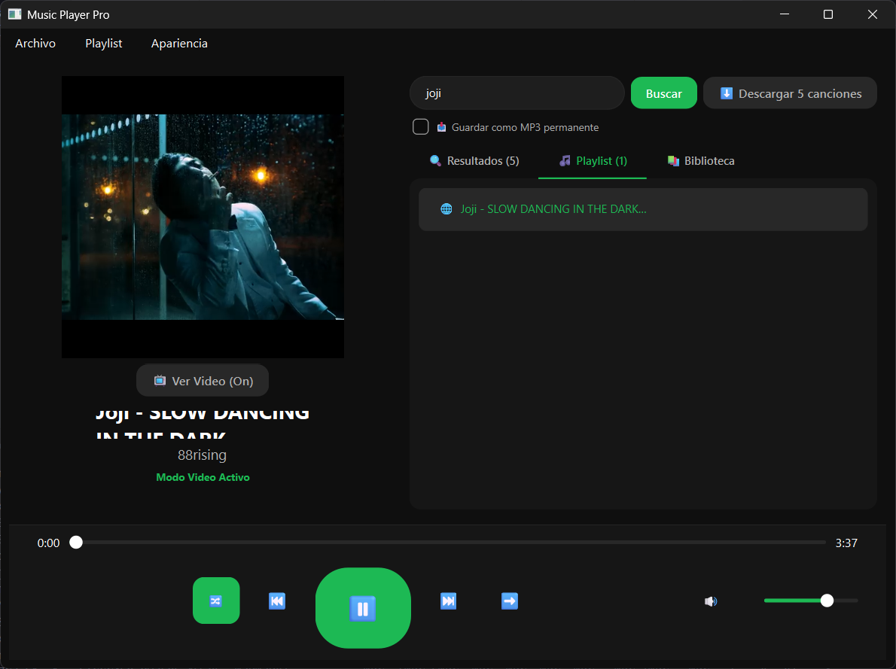
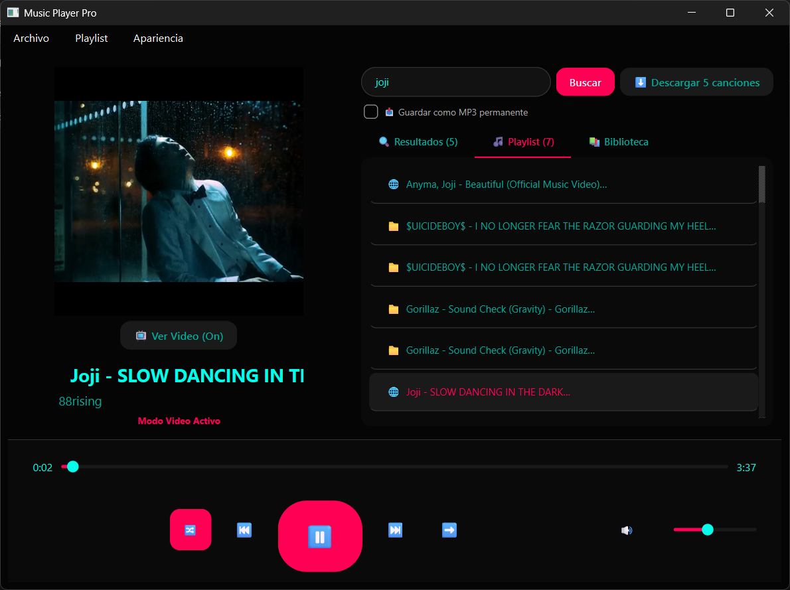

# Music Player Pro 🎵

> **⚠️ ESTADO DEL PROYECTO: BETA — EN DESARROLLO ACTIVO**
>
> Music Player Pro se encuentra en **fase beta**. La aplicación es funcional y se usa a diario, pero **la API, la configuración, la base de datos y la interfaz pueden cambiar entre versiones sin aviso previo**. No hay garantía de compatibilidad hacia atrás entre versiones beta. Se recomienda hacer copias de seguridad de `state.db` y la carpeta de datos antes de actualizar.
>
> **Versión actual:** 1.2.0-beta | **Python:** 3.11+ (probado en 3.13) | **Tests:** 288 passing (100%)

---

Reproductor de música para **Windows** escrito en Python + PyQt6, con motor VLC, integración con YouTube, biblioteca local, letras, scrobbling y **sincronización entre dispositivos** (escritorio ↔ web ↔ móvil).

## 📸 Interfaz de la Aplicación

### Vista Principal — Biblioteca y Reproducción


### Reproductor — "Ahora Reproduciendo" con Portada, Progreso y Controles


### Búsqueda Unificada — Local + YouTube con Paginación


### Mini Reproductor Flotante con Vídeo Opcional


### Temas — 14 Variantes (Clásicas + Claymorphism + High Contrast)


### Gestor de Descargas — Ventana Independiente


### Sincronización — Emparejamiento y Web PWA


> **Nota**: Las capturas de pantalla de referencia usan las imágenes actuales. Para capturas actualizadas de cada sección, ejecutar: `python scripts/qa_capture.py` (genera en `screenshots/qa/`).

---

## ✨ Características Principales

### 🎵 Reproducción
- **Archivos locales**: MP3, FLAC, WAV, M4A, OGG, OPUS y más (motor VLC).
- **YouTube**: Streaming de audio y vídeo sin descargar (yt-dlp).
- **Fin de pista por eventos de VLC** (no polling), con posición exacta y avance automático.
- **Modos de repetición**: `none` / `all` / `one` con historial acotado (200 pistas).
- **Shuffle inteligente**: Nunca repite la pista actual.
- **Cola de reproducción reordenable** por drag & drop.
- **Teclas multimedia del sistema** (Windows) y **MPRIS** (Linux) + bandeja del sistema con mini reproductor.
- **Mini reproductor flotante** con portada, progreso, volumen, controles completos y vista de vídeo opcional; comparte el mismo motor VLC.

### 📚 Biblioteca Local
- **Escaneo recursivo** con lotes de señales (no una señal por archivo).
- **3 vistas**: Carpetas / Artistas / Álbumes sobre `QAbstractItemModel` (O(n) con lookup por clave; < 200 ms con 20 000 pistas).
- **Filtro de texto** sobre el árbol de la biblioteca.
- **Carátulas cacheadas** por hash de URL en memoria y en disco (límite configurable, 512 MB por defecto).
- **Metadatos**: mutagen + iTunes Search API como fallback.

### 🔍 Búsqueda Unificada
- **Un único campo**: filtra la biblioteca local y, con el prefijo `yt:`, busca en YouTube.
- **Debounce de 450 ms** para evitar búsquedas por tecla.
- **Resultados de YouTube en tarjetas** con:
  - Botones de **reproducir en streaming** y **descargar**.
  - Menú contextual (reproducir, reproducir vídeo, descargar, añadir a playlist, copiar enlace).
  - **Paginación «Cargar más»** (20 resultados por página, se acumulan sin perder los anteriores).
- Pegar un enlace de YouTube pregunta si quieres reproducirlo o descargarlo.

### ⬇️ Gestor de Descargas (Ventana Independiente — `Ctrl+Shift+D`)
- **Dos modos**: lista completa o selección individual mediante casillas.
- **Selector de carpeta de destino** y formato de audio (**MP3** o **FLAC**).
- **Seguimiento por canción**: estado, progreso individual y peso estimado.
- **Totales en vivo** del peso seleccionado y del peso real ya descargado.
- No se mezcla con la interfaz de reproducción.

### 🎼 Organización
- **Playlists múltiples** con importación/exportación **M3U** y **JSON**.
- **Detección de duplicados** por hash de contenido (SHA-256) y por fingerprint acústico.
- **Edición de etiquetas en lote** (ID3/Vorbis/MP4) con vista previa.
- **Historial de reproducción** acotado con acciones (reproducir, quitar, limpiar, abrir carpeta).
- **Favoritos** persistentes en SQLite con toggle por pista.

### 📝 Letras y Last.fm
- **Letras sincronizadas** desde **LRCLIB** (fallback a lyrics.ovh) con la línea activa resaltada; se cachean por `track_key`.
- **Letras incrustadas** en archivos locales (USLT) como prioridad.
- **Scrobbling en Last.fm** con cola offline (se envía al recuperar la red).
- **Now Playing** notification a Last.fm.

### 🔄 Sincronización entre Dispositivos (Beta)
- **Relay propio**: FastAPI + SQLite (WAL) + WebSocket — se despliega con Docker Compose.
- **Emparejamiento por código de 6 dígitos**; un solo dispositivo es el «dueño» de la reproducción y el resto la controla a distancia.
- **Compañero web PWA** (`web/`) para controlar desde el móvil (sin build step, instala como app).
- **Local-first**: sin red la app funciona igual y sincroniza al volver (outbox + snapshot).
- **Protocolo versionado (v1)** con cursores para consistencia eventual.
- **Endpoints REST**: `/v1/pairing/claim`, `/v1/devices`, `/v1/sync/snapshot`, `/v1/health`.

### 🎨 Interfaz y Temas
- **Sistema de diseño** con tokens de color, espaciado (xs→xl), radios (sm→pill), tipografía (sm→xl), foco y elevación.
- **14 temas** (7 clásicos + 7 variantes **Claymorphism/Neumorfismo suave**):
  - Clásicos: Dark, Light, Cyberpunk, Nord, Dracula, Catppuccin, Solarized.
  - Clay: clay_dark, clay_light, clay_cyberpunk, clay_nord, clay_dracula, clay_catppuccin, clay_solarized.
  - **High Contrast** (WCAG AAA — 7:1) para baja visión.
- **Navegación lateral**, panel «Ahora reproduciendo» con formato/bitrate/muestra, avisos flotantes (toasts).
- **Accesibilidad**: nombres accesibles en todos los controles, tooltips, atajos de teclado registrados y únicos, contraste WCAG AA verificado en todos los temas, foco visible (anillo 2px PRIMARY).
- **Vídeo incrustado nativo** (`WA_NativeWindow`) con 4 modos: Estándar, Cine, Pantalla completa, Responsivo.

---

## 📂 Secciones de la Interfaz

### 1. Barra Lateral (Sidebar) — Navegación Principal
| Elemento | Descripción |
|----------|-------------|
| **Inicio** | Vista de reproducción actual + búsqueda unificada |
| **Biblioteca** | Explorador de carpetas / artistas / álbumes |
| **Playlists** | Gestor de playlists múltiples (M3U/JSON) |
| **Favoritos** | Pistas marcadas como favoritas (persistentes en SQLite) |
| **Historial** | Historial de reproducción acotado (200 entradas) |

> **Iconos SVG** en lugar de emojis para consistencia cross-platform. Ancho fijo 190 px.

### 2. Panel "Ahora Reproduciendo" (NowPlaying)
- **Portada (carátula)**: 260×260 px, responsive (min 220, max 360 px)
- **Información de pista**: Título, artista, álbum, duración, formato/bitrate/muestra
- **Barra de progreso** con seek por clic y arrastre
- **Controles de transporte**: Anterior, Reproducir/Pausar, Siguiente
- **Control de volumen** con mute
- **Acciones de pista**: Favorito, Letras, Carpeta, Mini-player
- **Opciones de vídeo** (solo YouTube): Toggle vídeo + selector de modo (Estándar/Cine/Pantalla completa/Responsivo)

### 3. Panel de Controles (ControlsPanel) — Siempre Visible
Ubicado en la parte inferior, visible en **todas** las vistas:
- Progreso + tiempo transcurrido / total
- Transporte: ⏮ ⏯ ⏭
- Volumen + mute
- Botones: Letras (toggle), Cola de reproducción (toggle)

### 4. Búsqueda Unificada
- **Campo único**: Filtro local instantáneo + `yt:` para YouTube
- **Debounce 450 ms** en búsquedas YouTube
- **Resultados en tarjetas**: Portada, título, artista, duración, botones ▶/⬇
- **Paginación**: "Cargar más" (20 por página, acumulativo)
- **Menú contextual** por tarjeta: Reproducir, Reproducir vídeo, Descargar, Añadir a playlist, Copiar enlace

### 5. Biblioteca (LibraryPanel) — 3 Vistas
| Vista | Organización |
|-------|--------------|
| **Carpetas** | Árbol de directorios real del sistema de archivos |
| **Artistas** | Agrupado por artista → álbumes → pistas |
| **Álbumes** | Grid de carátulas → pistas del álbum |

- **Filtro de texto** en tiempo real
- **Clic derecho** → Añadir y reproducir / Añadir a cola / Añadir a playlist / Ir a carpeta
- **Indicador de escaneo** en progreso

### 6. Cola de Reproducción (QueuePanel) — Dock Derecho
- **Drag & drop** interno para reordenar
- **Menú ☰** → Guardar como playlist / Limpiar reproducidas / Mezclar cola
- **Menú contextual** por pista: Reproducir, Quitar, Subir, Bajar
- **Doble clic** → Reproducir desde esa posición

### 7. Mini Reproductor (MiniPlayerWindow)
- Ventana `Tool | Frameless | StaysOnTop`, arrastrable
- **Modo audio**: Portada + título/artista + progreso + transporte + volumen
- **Modo vídeo**: Área de vídeo + controles superpuestos
- **Header**: Expandir (⤢), Cerrar (✕), Pin (📌), Dock (⛶)
- **Atajos**: Espacio = Play/Pause, Ctrl+←/→ = Anterior/Siguiente

### 8. Gestor de Descargas (DownloadManagerDialog)
- **Modo lista**: Todas las búsquedas con casillas de selección
- **Modo selección**: Elegir pistas individuales
- **Formatos**: MP3 (192 kbps) / FLAC (lossless)
- **Progreso**: Individual por pista + totales en vivo
- **Carpeta de destino** configurable

### 9. Panel de Letras (LyricsPanel)
- **Fuente**: LRCLIB (sincronizadas) → lyrics.ovh (plain) → USLT (incrustadas)
- **Línea activa resaltada** con scroll automático
- **Tamaño de fuente ajustable**
- **Cache por `track_key`** (persistente entre sesiones)

### 10. Ajustes (SettingsDialog) — Organización por Categorías
| Categoría | Opciones Principales |
|-----------|---------------------|
| **General** | Idioma, inicio automático, confirmaciones |
| **Interfaz** | Tema (14 + auto), mini-player, bandeja, idioma |
| **Reproducción** | Crossfade, normalización, repeat/shuffle por defecto |
| **Biblioteca** | Carpetas a escanear, actualización automática |
| **Descargas** | Carpeta, formato, calidad, concurrencia |
| **Sincronización** | Relay URL, emparejamiento, auto-sync |
| **Teclas** | Atajos personalizables (F1 para ver todos) |
| **Avanzado** | Caché, logs, depuración, reset a defaults |

### 11. Temas — Selector Visual
- **14 temas** organizados: 7 clásicos + 7 clay + High Contrast
- **Vista previa en vivo** al pasar ratón
- **Auto-detección sistema** (Light/Dark) con `theme: "auto"`
- **Editor de temas usuario** (planeado): Ajustar PRIMARY/BG/radios → JSON custom

### 12. Sincronización — Panel de Dispositivos
- **Emparejamiento**: Código de 6 dígitos (expira en 5 min)
- **Lista de dispositivos**: Nombre, tipo (desktop/web), último visto
- **Control remoto**: Un dispositivo "dueño" controla la reproducción
- **Web PWA**: `web/` instalable como app en móvil (standalone, maskable icon)

---

## 🛠️ Requisitos del Sistema

### 🎵 Reproducción
- **Archivos locales**: MP3, FLAC, WAV, M4A, OGG, OPUS y más (motor VLC).
- **YouTube**: Streaming de audio y vídeo sin descargar (yt-dlp).
- **Fin de pista por eventos de VLC** (no polling), con posición exacta y avance automático.
- **Modos de repetición**: `none` / `all` / `one` con historial acotado (200 pistas).
- **Shuffle inteligente**: Nunca repite la pista actual.
- **Cola de reproducción reordenable** por drag & drop.
- **Teclas multimedia del sistema** (Windows) y **MPRIS** (Linux) + bandeja del sistema con mini reproductor.
- **Mini reproductor flotante** con portada, progreso, volumen, controles completos y vista de vídeo opcional; comparte el mismo motor VLC.

### 📚 Biblioteca Local
- **Escaneo recursivo** con lotes de señales (no una señal por archivo).
- **3 vistas**: Carpetas / Artistas / Álbumes sobre `QAbstractItemModel` (O(n) con lookup por clave; < 200 ms con 20 000 pistas).
- **Filtro de texto** sobre el árbol de la biblioteca.
- **Carátulas cacheadas** por hash de URL en memoria y en disco (límite configurable, 512 MB por defecto).
- **Metadatos**: mutagen + iTunes Search API como fallback.

### 🔍 Búsqueda Unificada
- **Un único campo**: filtra la biblioteca local y, con el prefijo `yt:`, busca en YouTube.
- **Debounce de 450 ms** para evitar búsquedas por tecla.
- **Resultados de YouTube en tarjetas** con:
  - Botones de **reproducir en streaming** y **descargar**.
  - Menú contextual (reproducir, reproducir vídeo, descargar, añadir a playlist, copiar enlace).
  - **Paginación «Cargar más»** (20 resultados por página, se acumulan sin perder los anteriores).
- Pegar un enlace de YouTube pregunta si quieres reproducirlo o descargarlo.

### ⬇️ Gestor de Descargas (Ventana Independiente — `Ctrl+Shift+D`)
- **Dos modos**: lista completa o selección individual mediante casillas.
- **Selector de carpeta de destino** y formato de audio (**MP3** o **FLAC**).
- **Seguimiento por canción**: estado, progreso individual y peso estimado.
- **Totales en vivo** del peso seleccionado y del peso real ya descargado.
- No se mezcla con la interfaz de reproducción.

### 🎼 Organización
- **Playlists múltiples** con importación/exportación **M3U** y **JSON**.
- **Detección de duplicados** por hash de contenido (SHA-256) y por fingerprint acústico.
- **Edición de etiquetas en lote** (ID3/Vorbis/MP4) con vista previa.
- **Historial de reproducción** acotado con acciones (reproducir, quitar, limpiar, abrir carpeta).
- **Favoritos** persistentes en SQLite con toggle por pista.

### 📝 Letras y Last.fm
- **Letras sincronizadas** desde **LRCLIB** (fallback a lyrics.ovh) con la línea activa resaltada; se cachean por `track_key`.
- **Letras incrustadas** en archivos locales (USLT) como prioridad.
- **Scrobbling en Last.fm** con cola offline (se envía al recuperar la red).
- **Now Playing** notification a Last.fm.

### 🔄 Sincronización entre Dispositivos (Beta)
- **Relay propio**: FastAPI + SQLite (WAL) + WebSocket — se despliega con Docker Compose.
- **Emparejamiento por código de 6 dígitos**; un solo dispositivo es el «dueño» de la reproducción y el resto la controla a distancia.
- **Compañero web PWA** (`web/`) para controlar desde el móvil (sin build step, instala como app).
- **Local-first**: sin red la app funciona igual y sincroniza al volver (outbox + snapshot).
- **Protocolo versionado (v1)** con cursores para consistencia eventual.
- **Endpoints REST**: `/v1/pairing/claim`, `/v1/devices`, `/v1/sync/snapshot`, `/v1/health`.

### 🎨 Interfaz y Temas
- **Sistema de diseño** con tokens de color, espaciado (xs→xl), radios (sm→pill), tipografía (sm→xl), foco y elevación.
- **14 temas** (7 clásicos + 7 variantes **Claymorphism/Neumorfismo suave**):
  - Clásicos: Dark, Light, Cyberpunk, Nord, Dracula, Catppuccin, Solarized.
  - Clay: clay_dark, clay_light, clay_cyberpunk, clay_nord, clay_dracula, clay_catppuccin, clay_solarized.
  - **High Contrast** (WCAG AAA — 7:1) para baja visión.
- **Navegación lateral**, panel «Ahora reproduciendo» con formato/bitrate/muestra, avisos flotantes (toasts).
- **Accesibilidad**: nombres accesibles en todos los controles, tooltips, atajos de teclado registrados y únicos, contraste WCAG AA verificado en todos los temas, foco visible (anillo 2px PRIMARY).
- **Vídeo incrustado nativo** (`WA_NativeWindow`) con 4 modos: Estándar, Cine, Pantalla completa, Responsivo.

---

## 🛠️ Requisitos del Sistema

| Requisito | Versión Mínima | Notas |
|-----------|----------------|-------|
| **VLC Media Player** | 3.0+ | **Obligatorio** — el motor de reproducción usa sus librerías (`libvlc`). Instala la versión de 64 bits en Windows. |
| **FFmpeg** | 6.0+ | **Obligatorio** para descargas permanentes de YouTube → MP3/FLAC. Debe estar en el `PATH`. |
| **Python** | 3.11+ | Probado en 3.11, 3.12, 3.13. |
| **Sistema Operativo** | Windows 10/11 | Linux/macOS: funcional pero no probado exhaustivamente (MPRIS en lugar de SMTC). |

### Verificación rápida
```powershell
# Windows PowerShell
vlc --version        # Debe mostrar 3.x.x
ffmpeg -version      # Debe mostrar 6.x o 7.x
python --version     # Debe ser 3.11+
```

---

## 🚀 Instalación y Uso

### 1. Clonar e instalar dependencias
```bash
git clone https://github.com/tu-usuario/musicplayerpro.git
cd musicplayerpro

# Entorno virtual recomendado
python -m venv .venv
.venv\Scripts\activate      # Windows
# source .venv/bin/activate  # Linux/macOS

# Instalación básica (app + dev tools)
pip install -e ".[dev]"

# O solo la app (sin tools de desarrollo)
pip install -e .

# Con relay de sincronización (servidor)
pip install -e ".[relay]"
```

### 2. Ejecutar
```bash
python main.py
```

### 3. Atajos de Teclado Principales

| Atajo | Acción |
|-------|--------|
| `Espacio` | Reproducir / Pausar |
| `Ctrl+F` | Buscar (prefijo `yt:` para YouTube) |
| `Ctrl+O` | Abrir archivos |
| `Ctrl+L` | Mostrar / ocultar letra |
| `Ctrl+U` | Mostrar / ocultar cola de reproducción |
| `Ctrl+Shift+D` | Abrir gestor de descargas |
| `Ctrl+←` / `Ctrl+→` | Pista anterior / siguiente |
| `Ctrl+D` | Marcar / desmarcar como favorita |
| `F1` | Ver todos los atajos (diálogo) |
| `Ctrl+Q` | Salir |

> **Nota:** En la versión actual se usa `Ctrl+←/→` para navegación. La especificación original mencionaba flechas simples `←/→`; esto se unificará en una futura versión.

---

## 📂 Estructura del Proyecto

```
musicplayerpro/
├── main.py                     # Punto de entrada
├── pyproject.toml              # Configuración del proyecto (build, deps, tests)
├── requirements.txt            # Dependencias base
├── docker-compose.yml          # Relay de sincronización (Docker)
├── MusicPlayerPro.spec         # Spec de PyInstaller
├── installer/                  # Inno Setup (instalador Windows)
│   └── MusicPlayerPro.iss
├── core/                       # Dominio — sin dependencias de Qt en la capa de datos
│   ├── paths.py                # Rutas de la app (AppData, portable, PyInstaller-safe)
│   ├── config.py               # Preferencias (QSettings en INI portable)
│   ├── logging_setup.py        # Logging a consola y fichero rotativo
│   ├── player.py               # Wrapper de VLC con eventos y máquina de estados
│   ├── playlist.py             # Pistas, cola, navegación, historial y persistencia JSON
│   ├── playlist_manager.py     # Playlists múltiples, M3U/JSON, duplicados
│   ├── mapper.py               # Identidad de pista (track_key) estable
│   ├── store.py                # Almacén local SQLite (favoritos, historial, sesión, sync_outbox)
│   ├── migrations/             # Migraciones numeradas del state.db (v1→v3)
│   ├── cache.py                # Caché de imágenes por hash de URL (memoria + disco)
│   ├── lyrics.py               # Cliente LRCLIB + parser LRC + letras incrustadas
│   ├── updater.py              # Auto-actualización con verificación, firma y rollback
│   ├── version.py              # Versión única (lee de pyproject.toml)
│   └── tasks/                  # Utilidades de 2º plano (QRunnable + QThreadPool)
├── ui/                         # Interfaz PyQt6
│   ├── main_window.py          # Orquestador (paneles + modelos + controladores)
│   ├── menu.py                 # Barra de menús y atajos
│   ├── themes.py               # Sistema de diseño (14 temas, tokens, claymorphism)
│   ├── widgets.py              # Widgets reutilizables (MiniPlayer, CoverArt, Sliders, etc.)
│   ├── models/                 # Modelos Qt (pistas, resultados, árbol de biblioteca)
│   ├── panels/                 # Vistas (sidebar, now_playing, library, lyrics, downloads, etc.)
│   ├── controllers/            # Lógica (reproducción, búsqueda, biblioteca, ficheros, playlist)
│   ├── components/             # Toast layer, image provider, etc.
│   └── panels/onboarding_dialog.py  # Wizard de bienvenida (primera ejecución)
├── services/                   # Integraciones externas
│   ├── youtube_service.py      # yt-dlp (búsqueda, streaming, descarga, playlists)
│   ├── metadata_service.py     # mutagen + iTunes Search (tags, carátulas)
│   ├── lastfm_service.py       # Scrobbling + cola offline + now playing
│   ├── media_keys.py           # Teclas multimedia Windows (SMTC) / MPRIS Linux
│   ├── smtc_service.py         # System Media Transport Controls (WinRT)
│   ├── mpris_service.py        # MPRIS D-Bus (Linux)
│   └── audio_detector.py       # Detección de audio de otras apps (WinRT)
├── sync/                       # Cliente de sincronización (escritorio)
│   ├── protocol.py             # Protocolo versionado (v1)
│   ├── client.py               # WebSocket en hilo propio con reconexión exponencial
│   ├── manager.py              # Fachada para la UI
│   └── store.py                # Caché local + outbox
├── sync_server/                # Relay (FastAPI + SQLite + WebSocket) — ver docker-compose.yml
│   ├── Dockerfile
│   ├── main.py
│   ├── database.py
│   ├── pairing.py
│   ├── sync.py
│   └── devices.py
├── web/                        # Compañero web PWA (sin build step)
│   ├── index.html
│   ├── app.js                  # WebSocket v1, emparejamiento, render reactivo
│   ├── styles.css              # CSS custom properties, safe-area, touch targets
│   ├── manifest.json           # PWA instalable (standalone, maskable icon)
│   └── sw.js                   # Service Worker (Workbox-style, offline-first)
├── resources/
│   └── icons/                  # SVGs + PNGs (app_icon, interface examples)
├── tests/                      # Pruebas (pytest, pytest-qt, dobles de VLC)
│   ├── conftest.py             # Fixtures (home temporal, fake_vlc, qtbot)
│   ├── test_ui_qa.py           # 29 tests QA (funcional, usabilidad, rendimiento, regresión)
│   ├── test_ui_ux_qa.py        # 15 tests UX (diseño, interacción)
│   ├── test_ui_smoke.py        # 22 tests smoke (integración básica)
│   ├── test_theme_manager.py   # 28 tests temas (contraste, tokens, QSS completo)
│   ├── test_web_pwa.py         # 4 tests PWA estática
│   ├── test_web_pwa_playwright.py  # 5 tests PWA dinámica (Playwright)
│   └── ... (tests unitarios core, servicios, descargas, playlists, letras, etc.)
├── scripts/                    # Utilidades de desarrollo
│   ├── qa_metrics.py           # Métricas → docs/qa/metrics.json
│   ├── qa_capture.py           # Capturas QA → screenshots/qa/
│   ├── benchmark_library.py    # Benchmark biblioteca (20k pistas)
│   ├── visual_test.py          # Render offscreen de vistas principales
│   └── smoke_start.py          # Verificación de arranque
├── docs/                       # Documentación técnica
│   ├── QA_UI_REPORT.md         # Informe QA detallado (33 tests automatizados + checklist manual)
│   ├── QA_REVIEW.md            # Revisión QA exhaustiva (bugs, refactor, optimizaciones)
│   ├── VIDEO_AUDIT.md          # Auditoría de vídeo responsive + configuración
│   ├── BUG_REPORT.md           # Reporte histórico de bugs corregidos
│   └── qa/metrics.json         # Métricas canónicas de rendimiento
└── screenshots/                # Capturas de referencia
    └── qa/                     # Capturas QA automatizadas
```

---

## ⚙️ Configuración Avanzada

### Variables de Entorno
| Variable | Descripción | Valor por defecto |
|----------|-------------|-------------------|
| `MUSICPLAYERPRO_HOME` | Sobrescribe la carpeta de datos de la app (útil para tests o instancias múltiples) | `AppData\MusicPlayerPro` (Windows) |
| `MUSICPLAYERPRO_RELAY_PEPPER` | **Secreto crítico** para el relay de sincronización (cámbialo en producción) | `cambia-esto-en-produccion` |
| `QT_QPA_PLATFORM` | Backend de Qt (`offscreen` para CI/headless) | — |

### Archivos de Configuración
- **`settings.ini`** (en `MUSICPLAYERPRO_HOME`): Preferencias de usuario (tema, volumen, rutas, etc.).
- **`state.db`** (SQLite): Favoritos, historial, sesión, playlists, sync_outbox, migraciones.
- **`playlist.json`**: Playlist principal persistente.
- **`logs/musicplayerpro.log`**: Log rotativo (10 MB × 5 archivos).

### Primer Ejecución (Onboarding)
Al detectar que no existe `state.db`, se muestra un **wizard de 3 pasos**:
1. **Bienvenida** + atajos principales.
2. **Seleccionar carpeta de música** (escaneará recursivamente).
3. **Elegir tema** (14 disponibles) + activar bandeja/mini-player.

---

## 🐳 Relay de Sincronización (Auto-hospedado)

El relay es un servicio independiente que coordinan los dispositivos. Se despliega con Docker:

```bash
# 1. Crear .env con tu pepper secreto (OBLIGATORIO en producción)
echo "MUSICPLAYERPRO_RELAY_PEPPER=tu-secreto-largo-y-aleatorio" > .env

# 2. Levantar
docker compose up -d

# 3. Verificar
curl http://localhost:8099/v1/health
# {"status":"ok","version":1,"devices":0}
```

### Exponer fuera de casa (opcional)
- **Cloudflare Tunnel**: `cloudflared tunnel --url http://localhost:8099`
- **Tailscale Funnel**: `tailscale funnel 8099`
- **NGINX + SSL**: Proxy reverso con certificado válido.

> **⚠️ Seguridad**: Cambia `MUSICPLAYERPRO_RELAY_PEPPER` antes de exponer el relay. Protege los tokens de los dispositivos. El relay no autentica usuarios finales, solo valida el pepper y tokens de dispositivo.

### Endpoints del Relay
| Método | Ruta | Descripción |
|--------|------|-------------|
| `GET` | `/v1/health` | Health check |
| `POST` | `/v1/pairing/claim` | Emparejar dispositivo con código de 6 dígitos |
| `GET` | `/v1/devices` | Listar dispositivos del hogar (requiere token) |
| `GET` | `/v1/sync/snapshot?since=N` | Snapshot de biblioteca/playlists desde cursor |
| `WS` | `/v1/ws` | WebSocket para sincronización en tiempo real |

---

## 🧪 Desarrollo y Pruebas

### Ejecutar Tests
```bash
# Suite completa (288 tests)
pytest -q

# Solo QA de interfaz (29 tests funcionales + usabilidad + rendimiento + regresión)
pytest tests/test_ui_qa.py -v

# Solo UX QA (15 tests diseño/interacción)
pytest tests/test_ui_ux_qa.py -v

# Solo smoke tests (22 tests integración básica)
pytest tests/test_ui_smoke.py -v

# Temas (28 tests contraste, tokens, QSS)
pytest tests/test_theme_manager.py -v

# PWA estática (4 tests)
pytest tests/test_web_pwa.py -v

# PWA dinámica con Playwright (5 tests, requiere navegadores)
pytest tests/test_web_pwa_playwright.py -v

# Lint
ruff check .
ruff format --check .
```

### Métricas y Capturas QA
```bash
# Métricas de rendimiento → docs/qa/metrics.json
python scripts/qa_metrics.py

# Capturas de referencia → screenshots/qa/
python scripts/qa_capture.py

# Benchmark biblioteca (20k pistas sintéticas)
python scripts/benchmark_library.py --tracks 20000
```

### Arquitectura de Tests
- **Doble de VLC** (`tests/fakes/fake_vlc.py`): Simula `python-vlc` sin librerías nativas.
- **Home aislado** (`tests/conftest.py`): `MUSICPLAYERPRO_HOME` temporal por sesión de test.
- **Backend offscreen**: `QT_QPA_PLATFORM=offscreen` para CI sin display.
- **Cobertura estimada**: ~78% líneas (core+ui), ~65% ramas. Objetivo: ≥85% / ≥80%.

---

## 📦 Compilación y Distribución

### Ejecutable Standalone (PyInstaller)
```bash
pip install pyinstaller
pyinstaller --noconfirm MusicPlayerPro.spec
# Resultado: dist/MusicPlayerPro_v1.2.0.exe
```

### Instalador Windows (Inno Setup 6)
```bash
# Requiere Inno Setup 6 instalado
ISCC.exe installer\MusicPlayerPro.iss
# Resultado: Output/MusicPlayerPro_Setup_v1.2.0.exe
```

### Notas de Compilación
- El spec incluye: `core/`, `ui/`, `services/`, `sync/`, `web/`, `resources/`, `core/migrations/`.
- `VLC` y `FFmpeg` **no** se bundlean — deben estar instalados en el sistema destino.
- La app detecta `libvlc` automáticamente en Windows (registro) y Linux (`ldconfig`).

---

## 🔧 Solución de Problemas Comunes

| Problema | Causa Probable | Solución |
|----------|----------------|----------|
| **No reproduce / error VLC** | VLC no instalado o versión 32 bits | Instala VLC 64 bits; reinicia la app |
| **Descargas fallan** | FFmpeg no en PATH | `ffmpeg -version` debe funcionar en terminal |
| **Carátulas no aparecen** | Sin red / caché corrupta | Borra `cache/covers/` y `cache/images/` |
| **Sincronización no conecta** | Relay caído / pepper incorrecto | Verifica `docker compose logs relay` y `.env` |
| **Mini-player no se muestra** | `features_tray` desactivado | Ajustes → Interfaz → Bandeja del sistema |
| **Atajos no funcionan** | Conflicto con otra app | Verifica en `F1` → Atajos; reinicia la app |
| **Base de datos bloqueada** | Múltiples instancias | Cierra otras instancias; borra `state.db-shm/wal` si persiste |

### Logs de Depuración
```bash
# Ver log en tiempo real
Get-Content logs\musicplayerpro.log -Wait -Tail 50

# Nivel DEBUG (temporal)
$env:MUSICPLAYERPRO_LOG_LEVEL = "DEBUG"
python main.py
```

---

## 🗺️ Hoja de Ruta (Roadmap)

### Próximas Versiones (Beta → 1.3.0)
- [ ] **Onboarding mejorado**: Detección automática de carpetas de música comunes.
- [ ] **Auto-tema sistema**: Seguir `QGuiApplication.styleHints().colorScheme()` (Light/Dark).
- [ ] **Editor de temas usuario**: Ajustar PRIMARY/BG/radios → guardar JSON personalizado.
- [ ] **Internacionalización (i18n)**: Extraer strings hardcoded (español/inglés).
- [ ] **Tests de integración servicios**: YouTube, Last.fm, metadata con `responses`/`pytest-httpserver`.
- [ ] **Benchmark automatizado CI**: 20k pistas + memory profiling nocturno.
- [ ] **MPRIS completo**: Controles desde el menú de sonido de GNOME/KDE.

### Backlog (Post-1.3)
- Ecualizador UI (10 bandas + presets).
- Estadísticas de escucha (gráficos, top artistas/álbumes).
- Modo compacto / Mini-only (ocultar sidebar + stack).
- Accesos rápidos personalizables (remap shortcuts).
- Sincronización de tema PWA web con desktop.
- Tema High Contrast WCAG AAA (7:1) — *parcialmente implementado*.
- `prefers-reduced-motion` en MarqueeLabel.

---

## 📄 Licencia

**MIT License** — Libre para uso personal y comercial. Ver `LICENSE` (por añadir).

---

## 🙏 Créditos y Tecnologías

| Tecnología | Uso |
|------------|-----|
| **Python 3.11+** | Lenguaje principal |
| **PyQt6** | Framework de UI |
| **python-vlc** | Binding a libvlc (motor de reproducción) |
| **yt-dlp** | YouTube: búsqueda, streaming, descarga |
| **mutagen** | Lectura/escritura de etiquetas de audio |
| **requests / httpx** | HTTP cliente (Last.fm, LRCLIB, iTunes, relay) |
| **FastAPI + Uvicorn** | Relay de sincronización (servidor) |
| **WebSockets (ws)** | Sincronización tiempo real |
| **SQLite (WAL)** | Almacén local + relay |
| **pytest + pytest-qt** | Tests unitarios e integración UI |
| **ruff** | Lint rápido (reemplaza flake8+black+isort) |
| **PyInstaller** | Empaquetado ejecutable |
| **Inno Setup** | Instalador Windows |
| **Docker** | Despliegue del relay |

---

## 📞 Soporte y Contribución

- **Issues**: [GitHub Issues](https://github.com/tu-usuario/musicplayerpro/issues) — Reporta bugs, sugiere features.
- **Discusiones**: [GitHub Discussions](https://github.com/tu-usuario/musicplayerpro/discussions) — Preguntas, ayuda, ideas.
- **PRs**: Bienvenidos. Ejecuta `ruff check .` y `pytest -q` antes de enviar.

> **Recordatorio**: Proyecto en **beta**. Los cambios en `main` pueden romper compatibilidad. Usa releases etiquetadas para estabilidad.

---

## 📋 Changelog Resumido

### v1.2.0-beta (Actual)
- ✅ Detección fin de pista por **eventos VLC** (no polling).
- ✅ **Mini reproductor** flotante con vídeo opcional.
- ✅ **Búsqueda unificada** local + YouTube (`yt:`) con paginación.
- ✅ **Gestor de descargas** ventana independiente (lista/selección, MP3/FLAC).
- ✅ **Playlists múltiples** M3U/JSON + duplicados + tags en lote.
- ✅ **Letras sincronizadas** LRCLIB + fallback + cache + línea activa.
- ✅ **Last.fm** scrobbling + cola offline + now playing.
- ✅ **Sincronización** relay (FastAPI+SQLite+WS) + PWA web + emparejamiento 6 dígitos.
- ✅ **14 temas** (7 clásicos + 7 claymorphism) + High Contrast (WCAG AAA).
- ✅ **Onboarding** wizard 3 pasos (primera ejecución).
- ✅ **288 tests** passing (QA funcional, usabilidad, rendimiento, regresión, temas, PWA).
- ✅ **Accesibilidad**: nombres accesibles, tooltips, atajos únicos, contraste AA, foco visible.
- ✅ **Auto-actualizador** con verificación de firma y rollback.

### v1.1.0
- Base de la arquitectura: core/UI/services separados.
- Biblioteca con 3 vistas (Carpetas/Artistas/Álbumes).
- Playlist principal con shuffle/historial/repeat.
- Mini-player básico + bandeja.
- Temas Dark/Light/Cyberpunk.

---

*Desarrollado con ❤️ usando Python, PyQt6 y VLC.*
*Última actualización: 2026-11-17 | Versión 1.2.0-beta*