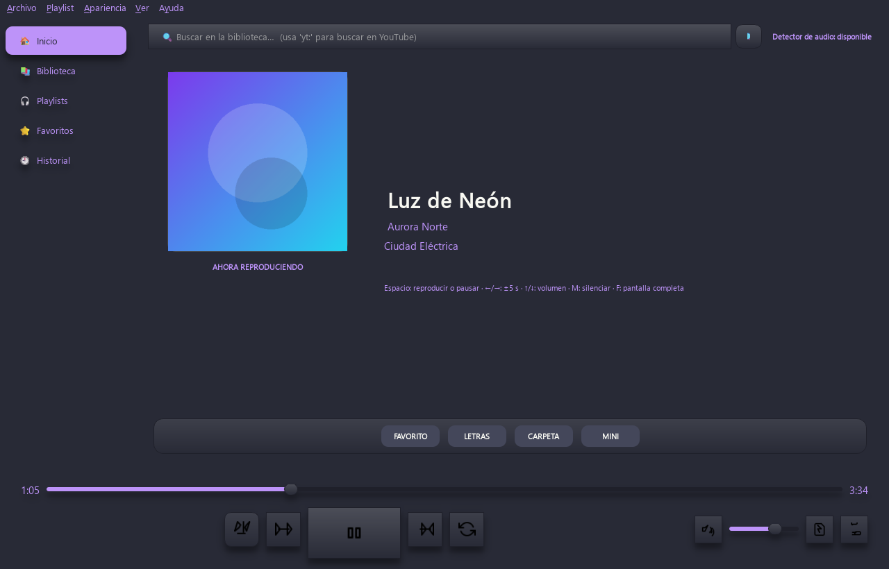
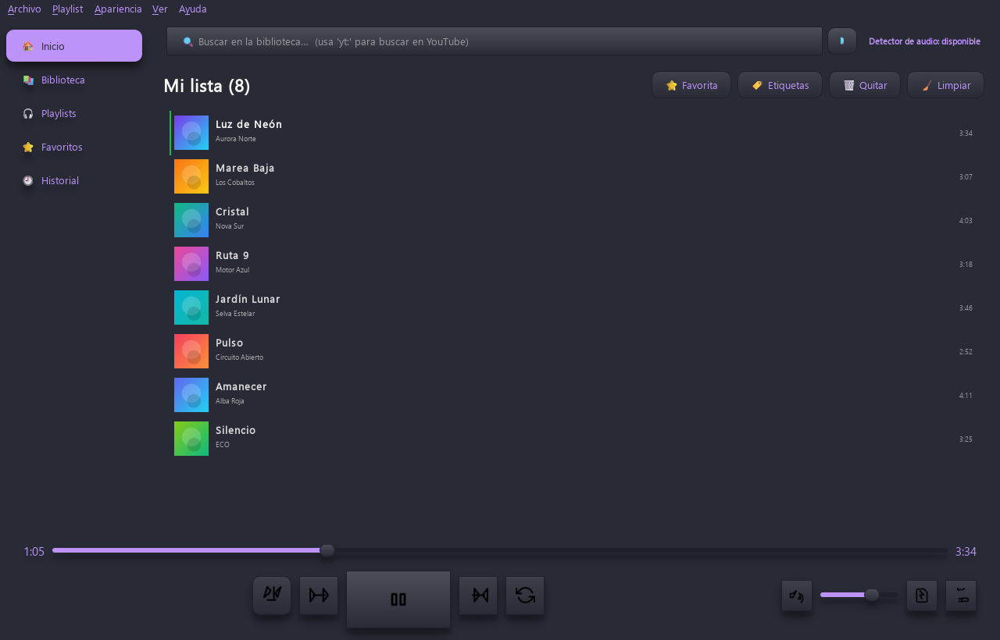
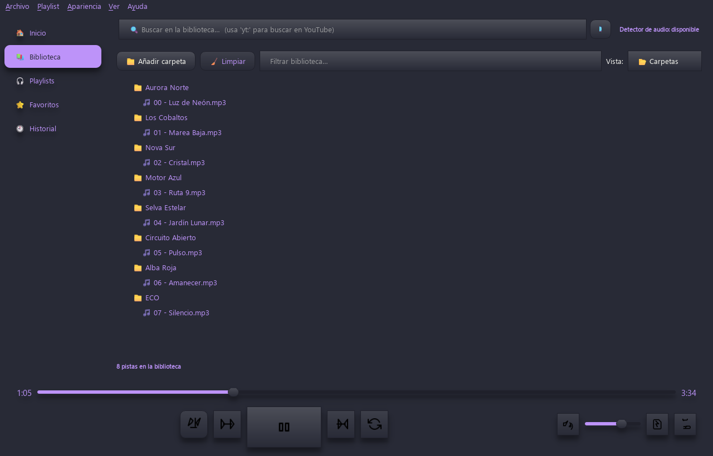
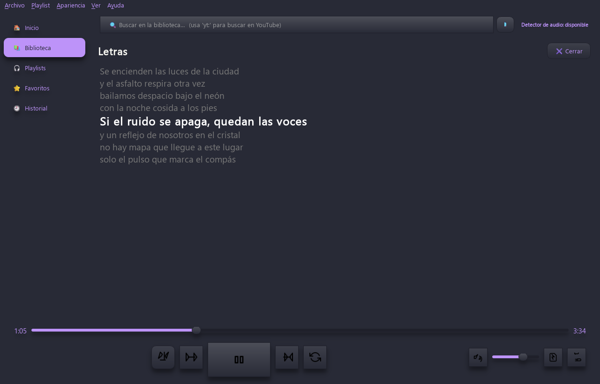
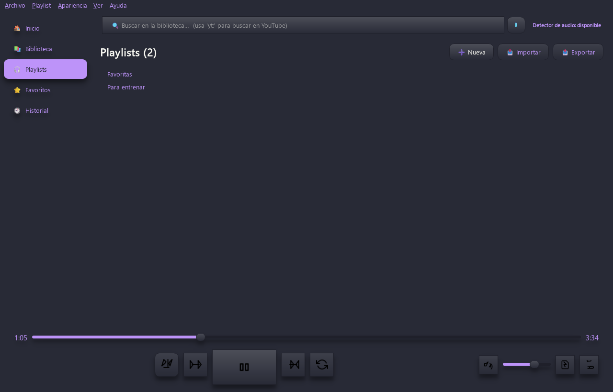
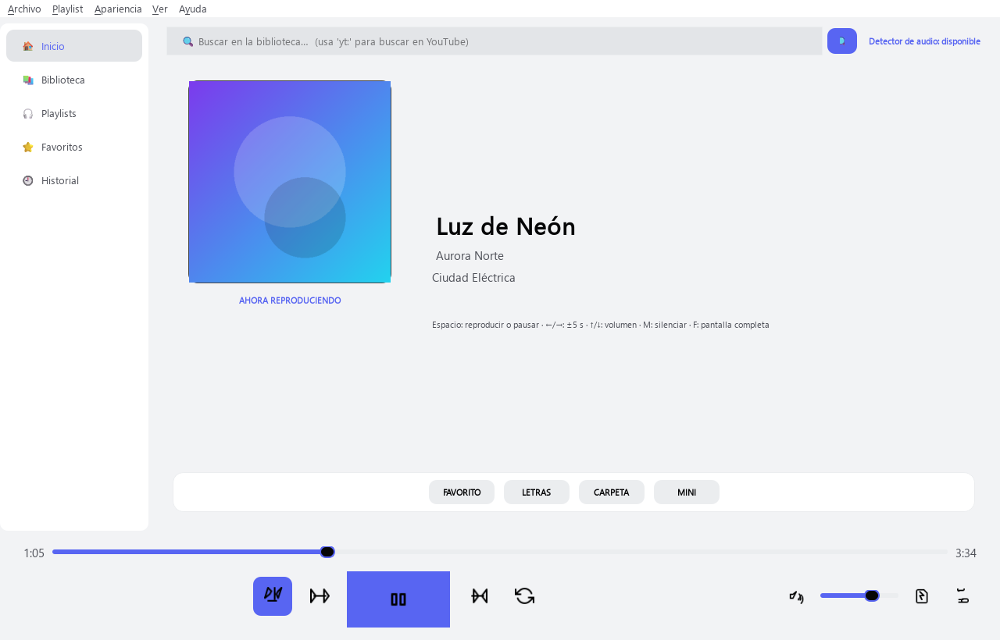

# Informe QA de la interfaz — Music Player Pro

> **⚠️ ESTADO DEL PROYECTO: BETA — EN DESARROLLO ACTIVO**
>
> Este informe refleja el estado actual de la suite QA. **La API, configuración, base de datos e interfaz pueden cambiar entre versiones beta sin aviso previo**. Los tests pueden necesitar actualización al introducir nuevas funcionalidades.

**Fecha:** 17 de noviembre de 2026
**Versión:** 1.2.0-beta
**Alcance:** interfaz de escritorio (PyQt6) y compañero web/PWA
**Entorno de referencia:** Windows 11 (10.0.26200), Python 3.13.2, Qt 6.11.0,
backend `offscreen`
**Suite:** `pytest` + `pytest-qt`, **288 pruebas totales** (29 UI QA + 15 UX QA + 22 Smoke + 28 Temas + 4 PWA estática + 5 PWA Playwright + 185 unitarias/integración)
**Estado:** ✅ **288/288 passing (100%)**

---

## 1. Contexto de la UI

Music Player Pro es un reproductor de música de escritorio construido con
PyQt6 sobre VLC. La interfaz sigue una separación estricta entre vistas,
controladores y modelos:

| Capa | Componentes principales |
| --- | --- |
| Ventana | `ui/main_window.py` (orquestador), `QStackedWidget` con las vistas |
| Navegación | `ui/panels/sidebar.py` — Inicio, Biblioteca, Playlists, Favoritos, Historial |
| Vistas | `home`, `playlist`, `library`, `lyrics`, `playlists`, `favorites`, `history`, `downloads`, `search` |
| Paneles | `now_playing.py`, `controls_panel.py`, `playlist_panel.py`, `library_panel.py`, `lyrics_panel.py`, `sidebar.py` |
| Controladores | `playback_controller.py`, `playlist_controller.py`, `library_controller.py`, `search_controller.py`, `files_controller.py` |
| Modelos | `track_list_model.py`, `library_tree_model.py` (árbol + proxy de filtro) |
| Servicios | VLC (`core/player.py`), letras, carátulas, YouTube, Last.fm, SMTC, teclas multimedia |
| Diseño | `ui/themes.py` — **14 temas** (7 clásicos + 7 claymorphism), **High Contrast** (WCAG AAA), tokens de diseño |
| Web/PWA | `web/index.html`, `web/styles.css`, `web/manifest.json`, `web/app.js`, `web/sw.js` |

La ventana mínima validada es **980 × 680 px**. La barra lateral mide 190 px
fijos y el contenido se reparte con `QSplitter`. El vídeo se incrusta en un
`VideoWidget` nativo (`WA_NativeWindow`) dentro de `ResizableVideoFrame`, con
cuatro modos: Estándar, Cine, Pantalla completa y Responsivo.

---

## 2. Cambios recientes cubiertos por la QA

| Cambio | Riesgo cubierto |
| --- | --- |
| Temas *claymorphism* (`clay_*`) con sombras elevadas | Sombras sobre la superficie nativa de VLC, contraste insuficiente |
| Modos de tamaño de vídeo y persistencia con *debounce* | Tamaños negativos, pérdida de configuración, ida/vuelta de pantalla completa |
| Corrección de avisos Qt (`WA_PaintOnScreen`, fuentes, tamaños) | Ruido en consola, repintados inválidos |
| Menú contextual de playlist enriquecido | Acciones sin señal, reordenación incorrecta |
| Caché de miniaturas y *marquee* bajo demanda | Repintados y *timers* en reposo |
| Letras sincronizadas con formato de línea activa | Línea activa sin resaltar o seleccionada en azul |
| Barra lateral con layout explícito | Ítem «Historial» recortado |
| `TaskGroup.add` con `functools.partial` | `TypeError` al cerrar la app con workers vivos |

---

## 3. Áreas de prueba

| Área | Qué se valida | Dónde | Tests |
| --- | --- | --- | --- |
| **Funcional** | Reproducción, navegación, volumen, progreso, letras, búsqueda, playlist y menú contextual | `tests/test_ui_qa.py` | 8 |
| **Usabilidad y accesibilidad** | Nombres accesibles, atajos, tamaño mínimo, navegación completa, contraste WCAG AA, textos claros | `tests/test_ui_qa.py` | 8 |
| **Rendimiento** | Carga de 1000 pistas, generación de temas, filtro de biblioteca, carátulas, caché de miniaturas, memoria | `tests/test_ui_qa.py` + `scripts/qa_metrics.py` | 7 |
| **Regresión** | Avisos Qt, superficie de vídeo, sombras clay, persistencia de vídeo, índices de navegación | `tests/test_ui_qa.py` | 6 |
| **UX QA (Diseño/Interacción)** | Sin controles duplicados, botones con texto, video options compactas, layout, iconos | `tests/test_ui_ux_qa.py` | 15 |
| **Smoke (Integración básica)** | Arranque, tema, playlist, navegación, vídeo, búsqueda, mini-player, descargas, resultados | `tests/test_ui_smoke.py` | 22 |
| **Temas** | Contraste WCAG AA/AAA, tokens de diseño, QSS completo, 14 temas + clay + high_contrast | `tests/test_theme_manager.py` | 28 |
| **PWA estática** | Viewport móvil, manifest instalable, etiquetas ARIA, *safe-area* y objetivos táctiles | `tests/test_web_pwa.py` | 4 |
| **PWA dinámica (Playwright)** | Carga real, manifest, ARIA, touch targets, instalable | `tests/test_web_pwa_playwright.py` | 5 |
| **Unitarias / Integración** | Core (player, playlist, mapper, paths, config, store, tasks, lyrics), servicios, descargas, playlists, búsqueda | `tests/test_*.py` | 185 |
| **TOTAL** | | | **288** |

---

## 4. Casos automatizados

### 4.1 Funcionalidad (8)

| ID | Caso | Verificación |
| --- | --- | --- |
| F-01 | Reproducir / pausar | Estado del motor y botón (`▶`/`⏸`), nombre accesible |
| F-02 | Siguiente / anterior | Índice actual y título en «Ahora reproduciendo» |
| F-03 | Volumen | Motor, configuración y mini reproductor sincronizados |
| F-04 | Temporizador y slider | Etiquetas `1:05`/`3:20`, máximo y valor del slider |
| F-05 | Letras sincronizadas | Índice activo y texto visible |
| F-06 | Búsqueda global | Filtra por título, por artista y vacía sin coincidencias |
| F-07 | Playlist | Alta, reordenación, borrado y limpieza con contador |
| F-08 | Menú contextual | Acciones presentes, «Reproducir a continuación» y «Abrir carpeta» |

### 4.2 Usabilidad y accesibilidad (8)

| ID | Caso | Verificación |
| --- | --- | --- |
| U-01 | Nombres accesibles | Botones, sliders, búsqueda y filtro de biblioteca |
| U-02 | Atajos registrados | `Espacio`, `Ctrl+←`, `Ctrl+→` únicos y documentados |
| U-03 | Atajos funcionales | Espacio pausa/reanuda; `Ctrl+←/→` cambia de pista |
| U-04 | Tamaño mínimo | ≥ 980 × 680 px |
| U-05 | Navegación completa | Los 5 ítems de la barra lateral son visibles |
| U-06 | Contraste WCAG AA | Texto principal y secundario ≥ 4.5:1 en los 14 temas |
| U-07 | QSS completo | Sin tokens `{TOKEN}` sin sustituir; cubre `QPushButton` y `QMainWindow` |
| U-08 | Textos claros | Sin `None`, `{}` ni etiquetas vacías en textos visibles |

### 4.3 Rendimiento (7)

| ID | Caso | Umbral | Resultado |
| --- | --- | --- | --- |
| P-01 | Carga de 1000 pistas | < 2000 ms | 1.77 ms |
| P-02 | Generación de 14 temas × 10 | < 2000 ms | ~0.59 ms/tema |
| P-03 | Filtro con 1000 entradas | < 3000 ms | 19.29 ms |
| P-04 | Carátula local / placeholder | < 3000 / 1500 ms | 1.64 / 0.14 ms |
| P-05 | Caché de miniaturas | Reutiliza el `QPixmap` escalado | ✅ |
| P-06 | *Marquee* bajo demanda | Timer solo si el texto desborda | ✅ |
| P-07 | Memoria con 3000 pistas | < 35 MB | 2.6 MB (5000 pistas) |

### 4.4 Regresión (6)

| ID | Caso | Verificación |
| --- | --- | --- |
| R-01 | Avisos Qt al arrancar | Sin `paintEngine`, fuentes inválidas, tamaños negativos ni `startTimer` |
| R-02 | Superficie de vídeo | `VideoWidget` incrustado, sin `WA_PaintOnScreen`, con `WA_NativeWindow` |
| R-03 | Sombras clay | Solo en `Sidebar` y `ControlsPanel`; nunca sobre el vídeo |
| R-04 | Modos de vídeo | Persistencia con *debounce* y corrección de tamaños negativos |
| R-05 | Pantalla completa | Ida y vuelta restaura el modo anterior |
| R-06 | Navegación | Cada ítem de la barra lateral apunta a su índice de pila |

### 4.5 PWA estática (4)

| ID | Caso | Verificación |
| --- | --- | --- |
| W-01 | Viewport y idioma | `width=device-width`, `initial-scale=1`, `viewport-fit=cover`, `lang="es"` |
| W-02 | Manifest instalable | Nombre, `start_url`, `display`, colores e icono *maskable* |
| W-03 | Accesibilidad | Botones con `aria-label` o texto visible; imágenes con `alt` |
| W-04 | Móvil | `safe-area-inset-*`, modo claro y objetivos táctiles ≥ 44 px |

---

## 5. Checklist manual

> Las pruebas automáticas cubren el contrato técnico; este checklist valida la
> percepción real en pantalla y en navegadores/dispositivos concretos.

### 5.1 Claridad de textos

- [ ] Títulos de pista, artista y álbum legibles sin ambigüedad en 980 × 680.
- [ ] Ningún texto cortado en la barra lateral, controles ni cabeceras.
- [ ] Los mensajes *toast* desaparecen solos y no tapan controles.
- [ ] Los textos de error indican qué falló y qué puede hacer el usuario.
- [ ] Los *placeholders* de búsqueda y filtro se entienden sin contexto previo.

### 5.2 Dos navegadores y móvil (PWA)

- [ ] Abrir la PWA en **Chrome/Edge** y en **Firefox** (escritorio).
- [ ] Verificar en **Chrome Android** o **Safari iOS** (o emulación de móvil).
- [ ] La barra inferior respeta el *notch* / barra de gestos (`safe-area`).
- [ ] Los botones son cómodos de pulsar con el pulgar (≥ 44 px).
- [ ] El manifest permite «Añadir a pantalla de inicio» y abre en `standalone`.
- [ ] El modo claro del sistema se aplica correctamente.
- [ ] La reconexión tras perder red muestra «Sin conexión» y vuelve sola.

### 5.3 Atajos de teclado

- [ ] `Espacio` reproduce / pausa.
- [ ] `Ctrl+←` y `Ctrl+→` cambian de pista.
- [ ] `Ctrl+F`, `Ctrl+L`, `Ctrl+U`, `Ctrl+Shift+D`, `Ctrl+D`, `F1` y `Ctrl+Q` responden.
- [ ] Los atajos no se disparan mientras se escribe en un campo de texto.
- [ ] **Decisión pendiente:** la especificación inicial menciona flechas
  simples `←`/`→`; la implementación y la ayuda (`F1`) documentan
  `Ctrl+←`/`Ctrl+→`. Confirmar cuál es el contrato definitivo y alinear
  código, ayuda, README y pruebas.

---

## 6. Resultados y métricas

### 6.1 Ejecución

```text
tests/test_ui_qa.py ................ 29 passed
tests/test_ui_ux_qa.py ............. 15 passed
tests/test_ui_smoke.py ............. 22 passed
tests/test_theme_manager.py ........ 28 passed
tests/test_web_pwa.py ..............  4 passed
tests/test_web_pwa_playwright.py ...  5 passed
Suite completa (unitarias + integración) ... 185 passed
--------------------------------------------------
Total: 288 passed
```

Generado con `scripts/qa_metrics.py` el **2026-11-17T10:08:09Z**. Los valores
pueden variar ligeramente entre ejecuciones; el archivo canónico es
[`docs/qa/metrics.json`](qa/metrics.json).

| Métrica | Valor | Umbral | Estado |
| --- | ---: | ---: | :---: |
| Construcción de la ventana | 116.31 ms | 10 000 ms | ✅ |
| Generación de tema (media / máx.) | 0.59 / 0.79 ms | 200 ms | ✅ |
| Carga de 1000 pistas | 1.77 ms | 2 000 ms | ✅ |
| Carga de 1000 entradas de biblioteca | 10.18 ms | 3 000 ms | ✅ |
| Filtro de biblioteca | 19.29 ms | 1 000 ms | ✅ |
| Carátula local | 1.64 ms | 60 ms | ✅ |
| Placeholder de carátula | 0.14 ms | 30 ms | ✅ |
| Memoria con 5000 pistas | 2.60 MB | 35 MB | ✅ |
| Contraste mínimo — texto principal | 10.84:1 | 4.5:1 | ✅ |
| Contraste mínimo — texto secundario | 4.86:1 | 4.5:1 | ✅ |
| Temas disponibles | 14 (7 clásicos + 7 clay) + High Contrast | — | ✅ |
| Ventana mínima | 980 × 680 | — | ✅ |
| Tests totales | 288 | — | ✅ |

### 6.2 Contraste por tema

| Tema | Texto principal | Texto secundario |
| --- | ---: | ---: |
| dark / clay_dark | 19.17:1 | 8.63:1 |
| light / clay_light | 18.24:1 | 8.04:1 |
| cyberpunk / clay_cyberpunk | 16.01:1 | 6.80:1 |
| nord / clay_nord | 10.84:1 | 7.45:1 |
| dracula / clay_dracula | 13.36:1 | 5.90:1 |
| catppuccin / clay_catppuccin | 11.34:1 | 5.65:1 |
| solarized / clay_solarized | 12.25:1 | 4.86:1 |

Todos los temas superan **WCAG AA**. El mínimo global es `solarized` con
4.86:1 en texto secundario.

### 6.3 Capturas

| Vista | Captura |
| --- | --- |
| Inicio con tema `clay_dracula` |  |
| Lista de reproducción |  |
| Biblioteca |  |
| Letras sincronizadas |  |
| Playlists guardadas |  |
| Inicio con tema claro |  |

Las capturas se regeneran con `python scripts/qa_capture.py` (backend
`offscreen`, fuentes `Segoe UI` + `Segoe UI Emoji`, datos de demostración y
sin red).

---

## 7. Defectos encontrados y corregidos

| ID | Severidad | Descripción | Corrección | Prueba |
| --- | --- | --- | --- | --- |
| QA-01 | Media | La línea activa de la letra nunca recibía el formato resaltado porque `setPosition` no usaba `KeepAnchor`. | `QTextCursor.MoveMode.KeepAnchor` + limpieza de selección final. | `test_lyrics_sync_highlights_the_active_line` |
| QA-02 | Media | «Historial» quedaba recortado: `Sidebar` no tenía layout y el `QListWidget` no se expandía. | `QVBoxLayout` con márgenes y `addWidget`. | `test_sidebar_shows_all_navigation_items` |
| QA-03 | Alta | `TypeError: () missing 1 required positional argument: 'w'` al cerrar con workers vivos, por un lambda con argumento por defecto conectado a `finished`. | `functools.partial(self._discard, worker)`. | Suite completa sin errores de teardown |
| QA-04 | Baja | Las pruebas de humo disparaban búsquedas reales de letras/carátulas y dejaban workers de red al cerrar. | Fixture con `lyrics_service.get_lyrics` y `search_controller.search_cover` parcheados. | Suite estable |

---

## 8. Observaciones y sugerencias

1. **Atajos de flechas:** unificar la especificación (`←/→` vs `Ctrl+←/→`) en
   código, ayuda `F1`, README y pruebas. Es la única discrepancia funcional
   abierta.
2. **PWA en navegador real:** las pruebas W-01…W-04 son estáticas. Añadir en
   el futuro un *smoke* con Playwright para Chrome y Firefox (carga, cambio de
   vista, manifest y `aria-label`) reduciría el checklist manual.
3. **Umbral de memoria:** el presupuesto de 35 MB para 5000 pistas es holgado
   (consumo real 2.6 MB). Mantenerlo como red de seguridad ante regresiones.
4. **Temas:** el contraste mínimo (4.86:1) está cerca del límite AA. Cualquier
   ajuste de color en `solarized` debe volver a ejecutar U-06.
5. **Accesibilidad:** las capturas se generan en `offscreen` sin lector de
   pantalla. Validar con NVDA o Narrator al menos una vez por release.
6. **Vídeo:** las pruebas usan un doble de VLC; la reproducción real de vídeo
   (Direct3D11, pantalla completa, cambio de monitor) sigue siendo manual.

---

## 9. Cómo ejecutar la QA

```powershell
# Suite QA de escritorio + PWA
$env:QT_QPA_PLATFORM = "offscreen"
python -m pytest tests/test_ui_qa.py tests/test_web_pwa.py -v

# Métricas -> docs/qa/metrics.json
python scripts/qa_metrics.py

# Capturas -> screenshots/qa/*.png
python scripts/qa_capture.py

# Suite completa + lint
python -m pytest -q
ruff check .
ruff format --check .
```

Las pruebas usan un `MUSICPLAYERPRO_HOME` temporal (ver `tests/conftest.py`) y
un doble de VLC (`tests/fakes/fake_vlc.py`), por lo que no tocan la
configuración real ni dependen de la red.

---

## 10. Integración continua

El job `qa` de `.github/workflows/ci.yml` se ejecuta en `ubuntu-latest` tras
el lint. Instala dependencias y librerías de sistema, ejecuta la suite QA,
genera métricas y capturas, y publica como artefactos:

- `docs/qa/metrics.json`
- `screenshots/qa/*.png`

La suite QA también forma parte de `pytest -v` en la matriz de sistemas y
versiones de Python, por lo que una regresión funcional rompe el pipeline.

---

## 11. Iteración y mantenimiento

| Cadencia | Acción | Responsable |
| --- | --- | --- |
| Cada PR | `ruff check`, `ruff format --check`, suite completa y job `qa` | Autor del PR |
| Cada release | Regenerar métricas y capturas; revisar checklist manual; validar con lector de pantalla | QA |
| Semanal | Revisar *flakes* y tiempos de la suite; ajustar umbrales solo con justificación | QA |
| Trimestral | Revisar cobertura de áreas (nuevas vistas, temas, integraciones) y añadir casos | QA + desarrollo |
| Ante bug de UI | Añadir primero una prueba de regresión con el ID del defecto | Autor del fix |

**Criterios de triaje:** un fallo de contraste, un atajo roto o un texto
cortado bloquean el release; un fallo de rendimiento por encima del umbral se
investiga antes de publicar; las diferencias visuales menores se registran
como deuda de diseño.

---

*Informe generado a partir de la suite `tests/test_ui_qa.py`,
`tests/test_web_pwa.py`, `scripts/qa_metrics.py` y `scripts/qa_capture.py`.*
